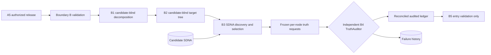

# MARA Segment B workbench

This branch implements Boundary B and B1-B4 as portable Python modules plus notebook orchestration. It stops at a validated B5-entry state and does not execute B5, Prism, résumé synthesis, layout, Boundary C, or advocacy.



## Run the fixture

```bash
PYTHONPATH=src python scripts/run_mara_b_fixture.py artifacts/mara-b
```

The fixture uses the repository's real candidate atoms at B3. TargetDecomposer, target classification, plane routing, selection, proposition construction, and TruthAuditor responses are simulated and explicitly labeled. No live model or B5 runtime is invoked.

## Contracts and custody

- Boundary B verifies A5 authorization, release integrity, sidecar lookup, and the immutable target source.
- B1 validates semantic adapter primitives against exact source spans and records origin/destination malforms.
- B2 requires every primitive to be classified and assigns deterministic lowercase addresses with bidirectional provenance.
- B3 routes from target nodes into real SDNA planes. Eligible, considered, and selected atom sets remain distinct. Its propositions are `NOT_AUDITED`.
- B4 creates write-disabled inspection requests containing only selected evidence. Reconciliation requires exactly one current response per B2 node, prohibits unselected citations, and prevents narrower outcomes from satisfying hard gates.
- The audited ledger carries `b5_executed: false`. It is an entry artifact, not B5 execution authority.

## A-to-B integration issue

The canonical Scout 13-field observation record contains `Source_URL` but not the complete target posting text required by B1. Boundary B therefore requires a separately integrity-bound `source_artifact` that resolves the authorized observation UUID to immutable source text. Production integration must define and verify the stationary source-artifact store referenced by A's sidecar. The fixture uses an in-memory synthetic artifact.

## Independent reasoning

The versioned adapter instructions are in `config/mara_b_reasoner_prompts.md`. Fixture responses validate interfaces only. Production completion still requires authorized implementations and live verification of TargetDecomposer, target classification, PlaneRouter, EvidenceSelector, PropositionBuilder, and TruthAuditor behavior, including intent-sensitivity checks.
