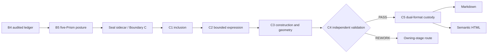

# MARA B5-C5 final-segment workbench

This branch consumes a reconciled B4 ledger and stops after C5 produces integrity-bound Markdown and HTML. It does not modify B1-B4, create cover letters, or claim production rendering.



Run the explicitly simulated fixture:

```bash
PYTHONPATH=src python scripts/run_mara_c_fixture.py artifacts/mara-c
```

## Controls

- B5 requires all five locked Prisms, totals exactly 100%, ties anchors to audited B4 evidence, and uses one of four semantic geometries.
- Boundary C seals the stationary sidecar and appends commitments to the Traveling Envelope.
- C1 preserves evidence references and ceilings while assigning explicit inclusion classes.
- C2 exactly covers traveling content and carries agency, chronology, association, evidence, and ceiling into every expression.
- C3 uses a versioned layout registry and declared metrics, rejects overflow, selects only approved variants, orders by semantic prominence, and records the complete anti-pattern register.
- C4 requires ten independent validation planes and never repairs another stage.
- C5 requires C4 PASS, detects renderer rewriting or order changes, checks content-ID parity, and creates distinct Markdown, HTML, and package commitments.

## Verification boundary

The local fixture renderer emits semantic HTML and supports deterministic content/order/hash checks. It does not run a browser, font engine, accessibility tree, PDF printer, screenshot comparison, or physical overflow measurement. Therefore responsive/print distortion remains `REQUIRES_RENDER_INSPECTION` at C3 and `geometry_inspection` remains `NOT_RUN` at C5. The Meta adapter prompt and request contract are ready for an authorized external renderer.
