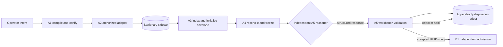

# SCOUT A1-A5 workbench

This branch adds a portable deterministic workbench and an independent reasoner boundary. It does not connect to a live runner, external storage, or a reasoning model.

## Stage boundaries



A1 accepts one to three scopes and produces certified cartridges without dispatch. A2 requires a certified cartridge and uses an explicit adapter. The included CLI permits only `SIMULATED`. A3 assigns deterministic UUIDv5 identities, stores evidence in a stationary sidecar, and carries references in an append-only envelope. A4 verifies hashes, lineage, and exact pointer traversal before producing an inspection-only submission. A5 prepares an immutable request and validates a separately supplied response. Only accepted UUIDs enter a B1 release package.

## Run the deterministic fixture

```bash
PYTHONPATH=src python scripts/run_scout_workbench.py \
  fixtures/scout_a_scope_fixture.json \
  fixtures/scout_a_records_fixture.json \
  artifacts/scout
```

This stops after constructing the A5 request. It does not invoke a reasoner. The generated artifacts are development evidence and the fixture is not an approved production Disk.

## Independent reasoner integration

Send `a5_reasoner_request.json` and `config/scout_a5_reasoner_prompt.md` to an operator-authorized reasoner outside the mechanical workbench. Feed the structured response into `record_a5_response`. The validator requires one evidence-citing disposition per submitted UUID and rejects unsupported or malformed decisions.

External adapters must be added behind explicit operator configuration. Credentials and paths belong in environment settings, never source. Opening the notebook performs no external action.

## Canonical observation contract

`contracts/scout_disk_studio_2_2_observation_contract.json` records the ordered 13-field contract supplied by the operator and sourced to the Scout Disk Studio 2.2.0 reference export. A1 requires that exact version, spelling, and order. A2 rejects missing, reordered, or unrecognized fields. The CLI uses duplicate-aware JSON parsing and rejects repeated keys before Python object construction. No silent field repair occurs.

The field-enumeration blocker is resolved. Remaining production integration requirements are verification against the original source export file, an operator-authorized taxonomy resolver and classification provenance, external storage policy, live runner adapter, and reasoner identity/version policy.
